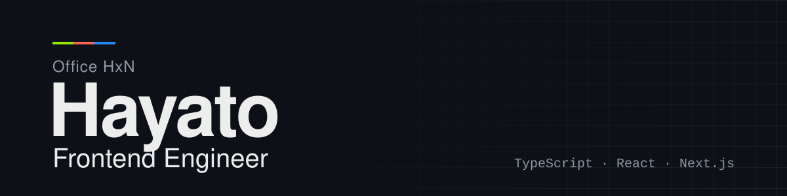

<picture>
  <source media="(prefers-color-scheme: dark)" srcset="assets/header-dark.svg">
  <source media="(prefers-color-scheme: light)" srcset="assets/header-light.svg">
  
</picture>

## About

I'm a freelance frontend engineer based in Japan, building websites and web applications with TypeScript, React, and Next.js.

## Tech Stack

<picture>
  <source media="(prefers-color-scheme: dark)" srcset="https://skillicons.dev/icons?i=ts%2Creact%2Cnextjs%2Cjs%2Ccss&theme=dark">
  <source media="(prefers-color-scheme: light)" srcset="https://skillicons.dev/icons?i=ts%2Creact%2Cnextjs%2Cjs%2Ccss&theme=light">
  
</picture>

## Works

- **[use-copy-ts](https://github.com/nhaya1000/use-copy-ts)**  
  Type-safe React hook for clipboard operations.
- **[GitHub Issue Image Slider](https://chromewebstore.google.com/detail/github-issue-image-slider/fenjealgpdmofkjamncnieioiiffpkoj)**  
  Chrome extension. View GitHub Issue images in an interactive slider with keyboard navigation and thumbnail previews. ([Source](https://github.com/nhaya1000/github-issue-image-slider))
- **[DevTools Vault](https://dev-tools-vault.office-hxn.com/)**  
  A collection of developer tools. Built with Next.js / React.
- **[サバイバルTypeScript](https://github.com/yytypescript/book)**  
  Contributor.

## Links

- Website: [office-hxn.com](https://www.office-hxn.com/)
- Qiita: [Office_HxN](https://qiita.com/Office_HxN)
- Chrome Web Store: [GitHub Issue Image Slider](https://chromewebstore.google.com/detail/github-issue-image-slider/fenjealgpdmofkjamncnieioiiffpkoj)

---

# 日本語

Hayato（Office HxN）

フロントエンドエンジニア

## 自己紹介

日本を拠点に活動するフリーランスのフロントエンドエンジニアです。TypeScript、React、Next.js で Web サイトや Web アプリケーションを作っています。

## 技術スタック

<picture>
  <source media="(prefers-color-scheme: dark)" srcset="https://skillicons.dev/icons?i=ts%2Creact%2Cnextjs%2Cjs%2Ccss&theme=dark">
  <source media="(prefers-color-scheme: light)" srcset="https://skillicons.dev/icons?i=ts%2Creact%2Cnextjs%2Cjs%2Ccss&theme=light">
  
</picture>

## 制作物

- **[use-copy-ts](https://github.com/nhaya1000/use-copy-ts)**  
  クリップボード操作のための型安全な React フック。
- **[GitHub Issue Image Slider](https://chromewebstore.google.com/detail/github-issue-image-slider/fenjealgpdmofkjamncnieioiiffpkoj)**  
  Chrome 拡張機能。GitHub の Issue 内の画像を、キーボード操作とサムネイルプレビューに対応したスライダーで表示します。（[ソース](https://github.com/nhaya1000/github-issue-image-slider)）
- **[DevTools Vault](https://dev-tools-vault.office-hxn.com/)**  
  開発者向けのツール集。Next.js / React で作っています。
- **[サバイバルTypeScript](https://github.com/yytypescript/book)**  
  コントリビューター。

## リンク

- Web サイト: [office-hxn.com](https://www.office-hxn.com/)
- Qiita: [Office_HxN](https://qiita.com/Office_HxN)
- Chrome ウェブストア: [GitHub Issue Image Slider](https://chromewebstore.google.com/detail/github-issue-image-slider/fenjealgpdmofkjamncnieioiiffpkoj)
